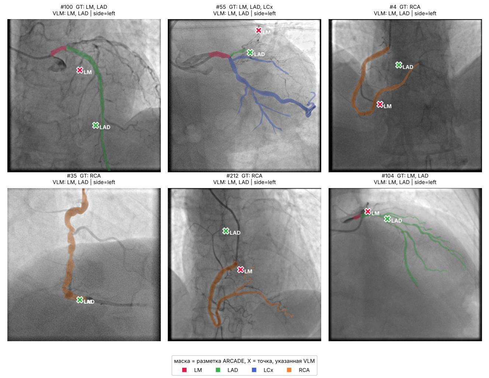
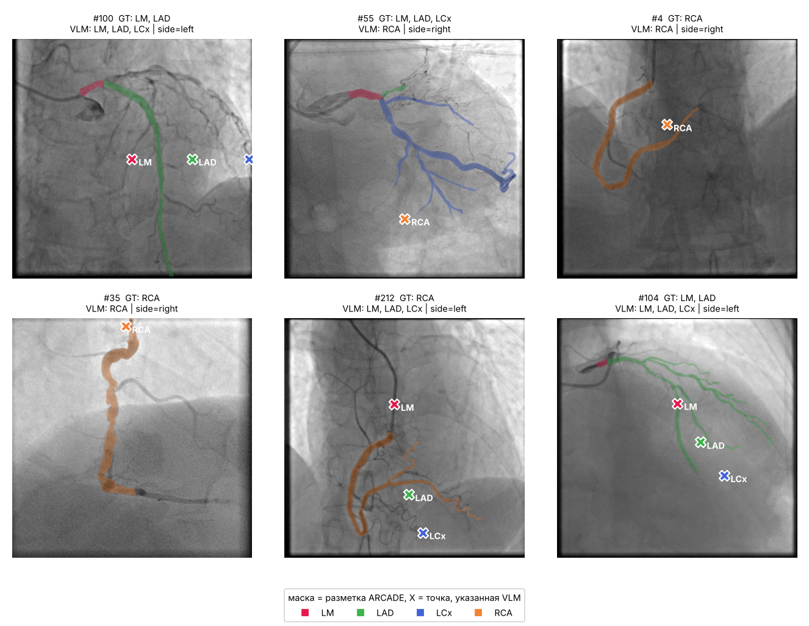
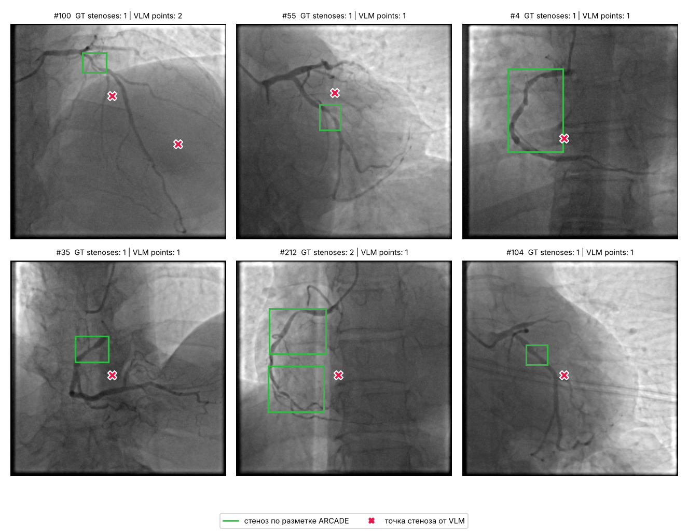

# Эксперимент 1: zero-shot VLM на ARCADE с RAG и без

*Отчёт № 1, ноябрь 2026*

## Кратко

Открытые VLM (Qwen2.5-VL-3B и -7B) без дообучения проверены на полной тестовой части ARCADE: 300 снимков с разметкой сегментов и 300 снимков с разметкой стенозов. Модель выдаёт структурированный JSON, каждое её утверждение сверяется с масками ARCADE.

- **Формат соблюдается, содержание — нет.** JSON корректен в 100% ответов. При этом **только 5–9% утверждений об артериях подтверждаются разметкой**, то есть артерия названа верно и указанная точка лежит на ней.
- **Ни одна конфигурация не превзошла тривиальный ответ.** Ответ «всегда левая система, LM + LAD» даёт точность по стороне 0.67 и F1 по артериям 0.64. Лучший результат у 7B без RAG: 0.66 и 0.65, то есть на уровне этого бейзлайна. Причина в том, что 7B **ни разу** не ответила «правая» и не назвала RCA: она воспроизводит частый шаблон, а не читает снимок.
- **3B без RAG** вообще не определяет сторону (100% `unknown`) и всегда отвечает «LAD» или «LAD + LCx».
- **RAG (3B)** изменил поведение модели: появились ответы «правая» и согласованные наборы «LM/LAD/LCx» или «только RCA», F1 по артериям вырос с 0.48 до 0.61. Но сторона определяется не лучше угадывания (0.64 при бейзлайне 0.67), а доля подтверждённых утверждений даже снизилась (7.1% → 4.7%).
- **Стенозы (3B).** 21% точек попадают в размеченный стеноз (95% ДИ 18–25%). Это в 4 раза лучше случайной точки (5.5%), но полнота 0.24, и в 100% случаев точка стеноза просто скопирована с точки артерии. С RAG модель стала чаще молчать (33% снимков без находок), полнота упала до 0.08.
- **Отказа от ответа нет.** Поле «не могу оценить» заполнено в 0–4 ответах из 300, хотя инструкция это прямо разрешает. Уверенность модели не отличает попадания от промахов (0.87 и 0.84).

**Вывод.** Малые открытые VLM в zero-shot режиме выдают правдоподобные, но почти не связанные со снимком описания. Текстовые метрики этого не покажут, а проверка привязки утверждений к маскам показывает. Это обосновывает центральную часть работы: структурированный вывод с обязательной локализацией и внешней проверкой каждого утверждения. RAG в простом виде меняет форму ответа, но не его фактическую точность.

## Постановка

**Данные.** Тестовая часть ARCADE (официальное разбиение):
- *syntax* — 300 снимков с масками 25 сегментов SYNTAX;
- *stenosis* — 300 снимков с масками 386 стенозов.

Подвыборки размечены независимо (на *syntax* нет стенозов, на *stenosis* — сегментов), поэтому артерии оцениваются на первой, стенозы — на второй.

**Эталон** строится автоматически из разметки. Сегменты сопоставлены артериям: 1–4, 16a–c → RCA; 5 → LM; 6–10a → LAD; 11–15 → LCx. Сторона «правая», если есть сегменты RCA. В тесте 200 левых и 100 правых инъекций, в среднем 5.6 размеченных сегмента и 1.3 стеноза на снимок.

**Модели.** Qwen2.5-VL-3B-Instruct (fp16) и Qwen2.5-VL-7B-Instruct (4 бита), Colab T4, жадная генерация, без дообучения. Пилот на 50 снимках (CPU, 3B) дал те же выводы.

**Формат ответа (JSON):**
```
side: left | right | unknown
arteries:  [{artery: LM|LAD|LCx|RCA, point: [x, y]}]
stenoses:  [{artery, point: [x, y], severity, confidence}]
not_assessable: [...]
```

**Варианты:**
- `base` — инструкция и схема;
- `rag` — плюс 6 фрагментов из базы знаний на 15 фрагментов (признаки левой/правой инъекции, сегменты SYNTAX, проекции, признаки стеноза и артефакты, правила заключения), поиск BM25. Запрос одинаков для всех снимков, поэтому фактически это статический анатомический контекст.

**Метрики.** Каждая сравнивается с тривиальным бейзлайном.

| Метрика | Что измеряет |
|---|---|
| Точность определения стороны | левая / правая инъекция |
| P / R / F1 по артериям | названные артерии vs размеченные |
| Утверждения о «чужой» системе | артерии левой системы при правой инъекции и наоборот |
| Точка на сосуде / на нужной артерии | попадание точки в маску (допуск 7 px) |
| **Подтверждённые утверждения** | артерия есть в разметке **и** точка лежит на её маске |
| Precision / recall точек стеноза | попадание в рамку стеноза (допуск 10 px) |

## Результаты

### Артерии и сторона (syntax, n = 300)

| | 3B base | 3B rag | 7B base | бейзлайн |
|---|---|---|---|---|
| Сторона определена верно | 0.00 (всегда `unknown`) | 0.64 | 0.66 (всегда «левая») | **0.67** («всегда левая») |
| Правые инъекции распознаны | 0 / 100 | 35 / 100 | 0 / 100 | 0 / 100 |
| F1 по артериям (P / R) | 0.48 (0.54 / 0.43) | 0.61 (0.57 / 0.67) | **0.65** (0.61 / 0.69) | 0.64 («всегда LM + LAD») |
| Утверждений на снимок | 1.6 | 2.4 | 2.3 | |
| Утверждения о «чужой» системе | 32% | 31% | 31% | |
| Точка на любом сосуде | 22% | 16% | **29%** | 8% (случайная точка) |
| Точка на названной артерии | 13% | 8% | **15%** | |
| **Подтверждённые утверждения** | 7.1% | 4.7% | **9.1%** | |

### Стенозы (stenosis, n = 300, 386 стенозов, модель 3B)

| | base | rag | бейзлайн |
|---|---|---|---|
| Precision точек | **0.21** (95% ДИ 0.18–0.25) | 0.14 (0.10–0.19) | 0.055 (случайная точка) |
| Recall | **0.24** | 0.08 | |
| Снимков без находок | 0% | 33% | (на всех снимках есть стеноз) |
| Точка стеноза = точка артерии | 100% | 96% | |
| Уверенность: попадания / промахи | 0.87 / 0.84 | 0.88 / 0.89 | |

### Примеры

Цветные маски — разметка ARCADE, крестики — точки, которые назвала модель.

**7B без RAG.** На всех шести снимках ответ «LM, LAD, левая», в том числе на трёх правых (#4, #35, #212).



**3B с RAG.** Модель начинает отвечать «правая / RCA», но не там, где нужно (#100, #55 — левые инъекции).



**3B, стенозы.** Зелёные рамки — разметка, крестики — точки модели.



## Наблюдения

1. **Шаблонные ответы вместо чтения снимка.** У 3B без RAG все 300 ответов — «LAD» или «LAD + LCx»; у 7B 283 из 300 — «LM + LAD» или «LM + LAD + LCx». Координаты повторяются: у 3B с RAG точка (252, 378) встречается 147 раз.
2. **Крупная модель «выигрывает» за счёт удачного шаблона.** 7B выглядит лучше по F1 только потому, что её шаблон совпадает с самым частым классом. Без сравнения с тривиальным бейзлайном это легко принять за понимание снимка.
3. **RAG меняет форму ответа сильнее, чем точность.** Контекст научил модель правилу «одна инъекция — одна система» и заставил использовать RCA. Но сторона определяется на уровне угадывания, поэтому ошибка стороны превращается в ошибку по всем артериям сразу. Доля подтверждённых утверждений с RAG снизилась.
4. **Отказ от ответа не вызывается инструкцией.** Нужен внешний механизм: проверка привязки или калиброванный порог.
5. **Уверенность модели бесполезна** как сигнал качества.
6. **Доля подтверждённых утверждений** — самая строгая и информативная метрика (5–9%). Её стоит сделать основной метрикой галлюцинаций.

## Ограничения

- Модели малого размера (3B, 7B в 4 битах); медицинские VLM (MedGemma, Lingshu и др.) пока не проверены.
- 7B проверена только без RAG и только на артериях (остальные прогоны оборвались по лимиту Colab).
- RAG в простейшем виде: статический контекст без поиска по признакам конкретного снимка.
- Разметка ARCADE может быть неполной (размечены не все видимые сегменты), это занижает precision по артериям.

## Следующие шаги

1. Досчитать 7B (RAG, стенозы) и добавить медицинские VLM.
2. **Двухэтапная генерация с RAG по анатомическим структурам:** сначала сторона и проекция, затем поиск фрагментов именно для этой системы и проекции, затем описание сегментов.
3. **Внешняя проверка привязки:** утверждения, точка которых не лежит на сосуде (по маске сосудов от сегментатора, обученного на ARCADE train), отбрасываются или помечаются «не подтверждено». Оценить снижение доли галлюцинаций и потерю полноты.
4. **Детектор сегментов** (YOLOv8-seg на ARCADE train) как «визуальный инструмент»: VLM получает найденные сегменты с координатами и формирует по ним описание.
5. Сравнение с дообученными моделями на этом же тесте (Jiang et al., 2026: F1 0.60 по стенозам, 0.46 по сегментам) и, возможно, LoRA-дообучение на ARCADE train.

## Воспроизведение

- Код: `src/` (эталон `gt.py`, RAG `rag.py`, прогон `run_vlm.py`, метрики `evaluate.py`, рисунки `viz.py`).
- База знаний: `kb/knowledge.jsonl`.
- Ноутбук для Colab: `notebooks/colab_run.ipynb`.
- Сырые ответы моделей: `results/colab/pred_*.jsonl`, метрики: `results/colab/metrics.json`.

```
python src/run_vlm.py --cond rag --task syntax --n 300 --device cuda --dtype fp16
python src/evaluate.py --results results/colab
```
